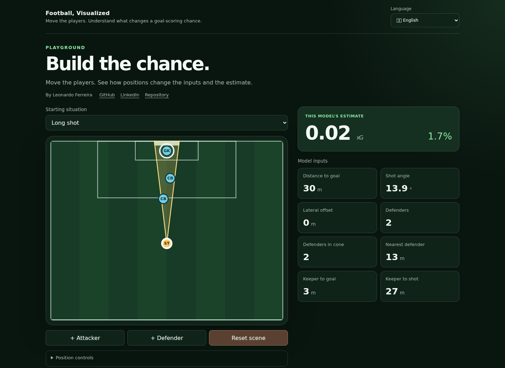

# Football, Visualized

An interactive xG playground for football fans, analysts and curious engineers. Move the shooter, goalkeeper and defenders to explore how eight positional inputs affect an independent model's estimate, then inspect the methodology behind it.

A portfolio project by **Leonardo Ferreira** · [GitHub](https://github.com/leovferreira13) · [LinkedIn](https://www.linkedin.com/in/leonardo-v-ferreira)



**[Open the live Playground](https://sports-data-visualizer-production.up.railway.app/en)**

**Status:** the Playground and Methodology/results run in Portuguese, English, Dutch, Spanish and German. The existing Railway demo is accessible; final domain metadata, branding review and public repository access remain tracked in [#26](https://github.com/leovferreira13/sports-data-visualizer/issues/26). See [release QA](docs/reports/public-release-qa.md) for observed results. Optional Learn experiments are deferred in #5.

## Explore the product

- Edit six illustrative presets, move players with mouse, touch or keyboard, and use position inputs as an accessible alternative.
- Inspect live xG, distance, shooting angle and six further retained model inputs beside the pitch.
- Add/remove up to three represented defenders. Additional attackers are visual only.
- Change language or reload within the same tab while retaining the scene.
- Read inline Methodology/results: model selection, held-out evaluation, calibration, support diagnostics and limitations.

## Engineering decisions

This project covers product scope, interaction design, a reproducible offline data/ML pipeline and browser delivery. The implementation deliberately keeps the production application small.

| Decision | Why it fits | Tradeoff |
| --- | --- | --- |
| Next.js/React with a metric SVG scene | Responsive mouse/touch/keyboard interaction; coordinates stay in meters while rendering adapts to the viewport | SVG and accessibility controls require careful coordinate/focus handling |
| Shared eight-feature contract in Python and TypeScript | Offline training and browser inference measure the same scene | Independent implementations require parity checks |
| Regularized logistic baselines and a shallow XGBoost candidate | Compare a simple reference with limited nonlinear interactions under a declared selection protocol | Trees can produce plateaus and nonmonotonic local responses |
| Offline training, parameter-only browser inference | No production inference API, database, Python runtime or private dataset | Export precision, loader validation and exact asset integrity must be verified |
| Exact-byte static model with SHA-256 verification | Preserve the original fitted envelope despite build-tool numeric rewriting | HTTPS/Web Crypto is needed; invalid/unavailable assets fail explicitly |
| One aggregate evidence source for reports and app tables | Reviewers see the same numbers in both presentations | Historical/generated evidence must remain immutable |

See the [architecture](docs/architecture/overview.md), [decision records](docs/architecture/adr/README.md) and [implementation summary](docs/reports/xg-implementation-summary.md) for the rationale and verification boundaries.

## Model evidence and limits

The independently trained shallow XGBoost uses StatsBomb Open Data embedded shot-frame observations. Selection and the final match-held-out test are separate; there was no post-test refit. The final cohort contains **363 matches, 7,160 shots and 655 goals**. All seven predeclared quantitative predicates passed; paired final probability-score intervals favored the selected model over full logistic and constant references within this cohort.

That result supports the educational portfolio's scope, not universal superiority or exact probabilities for a particular player. High-probability/extreme-distance groups and zero/few-defender scenes have limited support. Four of five open-play presets fall outside the training-only nearest-neighbor reference. The two-defenders-in-cone slice performed worse than full logistic. Player movement can leave tree estimates unchanged; comparisons describe the model, not real-world causality. Penalties use a separately labeled fixed **0.76 convention**, not the learned open-play model. Omitted factors include player skill and shot context beyond the retained positional inputs.

Local complete scientific reproduction was reported PASS; submitted aggregate identities, provenance and generated-view consistency were independently inspected. Private-row computation was not independently repeated in the review environment. [Final review](docs/reports/xg-final-evaluation.md), [generated methodology](docs/reports/xg-final-first-run/methodology.md), [model card](docs/reports/xg-final-first-run/model-card.md) and [integrated product QA](docs/reports/xg-playground-qa.md) document both evidence and limitations.

## Run locally

The web application requires **Node.js 20.9+ and npm**. Git and Python 3.10+ are needed for repository hooks/full checks; the offline training environment has its own [Python 3.12 dependency lock](docs/architecture/reference/xg-training.md). Private data and Python are not required to serve the built app.

```bash
npm ci
npm run dev
```

Open [http://localhost:3000/en](http://localhost:3000/en). Direct routes are `/en`, `/br`, `/nl`, `/es` and `/de`. `/` selects saved preference, then browser language, then English.

For a production build:

```bash
npm run build
npm start
```

Verification:

```bash
npm run check:precommit
npm run build
npm run check:localization
```

The canonical pre-commit check includes lint, TypeScript, unit tests, synthetic Python ingestion/feature checks, English Markdown and shell validation. Builds verify the original model/evidence identity before compiling. `npm ci` installs the Git hook through the prepare script.

For public hosting, set `SITE_URL` to the final HTTPS origin **before building**; no path, credentials or nonstandard port. Without it, local builds omit canonical/share-image URLs and disable indexing. [Presentation metadata](docs/architecture/reference/portfolio-presentation.md) and [Railway deployment/recovery](docs/architecture/reference/railway-deployment.md) document settings and repeatable live checks. `npm start` listens on `0.0.0.0` and reads the platform's PORT.

## A short reviewer walkthrough

1. Open `/en` and move the shooter. Distance/angle and xG update together; small movements may leave tree output unchanged.
2. Move the goalkeeper or a defender and inspect the relevant input cards. Add/remove a defender; extra attackers do not influence this model.
3. Try Penalty to see the separate convention, then return to an open-play preset.
4. Switch languages and check that the scene persists. Use arrow keys or position inputs to explore without dragging.
5. Scroll to Methodology/results, compare selection with final test, and inspect sparse calibration/support notes. Follow the references below for implementation and reproduction.

## Technical references

- [Product vision](docs/VISION.md) and [roadmap](docs/ROADMAP.md)
- [Pinned source ingestion](docs/architecture/reference/statsbomb-ingestion.md) and [aggregate data audit](docs/reports/xg-data-audit.md)
- [Feature contract and complete-run comparison](docs/architecture/reference/shot-features.md)
- [Training and reproduction](docs/architecture/reference/xg-training.md), [browser parity](docs/architecture/reference/prediction.md) and [final evaluation](docs/architecture/reference/xg-final-evaluation.md)
- [Integrated Playground](docs/architecture/reference/playground-and-methodology.md), [localization QA](docs/reports/localization-qa.md) and [portfolio QA](docs/reports/portfolio-presentation-qa.md)
- [Development process](docs/DEVELOPMENT_PROCESS.md) and [chat commands](docs/COMMANDS.md)

Offline reproduction uses separately obtained pinned source data and local immutable runs; public aggregate folders are evidence subsets, not complete private training runs. The guides specify comparator commands and permitted aggregate outputs.

## Source, attribution and reuse

<a href="https://github.com/hudl/open-data"></a>

Trained using [StatsBomb Open Data](https://github.com/hudl/open-data), subject to its [Public Data User Agreement](https://github.com/hudl/open-data/blob/master/LICENSE.pdf). StatsBomb provides the source data; it does not create or endorse this project or its independent model. The app retains source credit, the official logo and independent-project wording in all five languages. Source event/360 records and shot-level training examples are not redistributed here.

The intended use is a free, non-commercial professional portfolio without ads, paid services, raw-data hosting or resale. The logo comes from the [official Media Pack](https://statsbomb.com/media-pack/). See the [rights record](docs/architecture/reference/statsbomb-rights.md) for the conditional support response, scoped review and outstanding exact branding-guidance check.

No code license has been selected. Public visibility alone does not grant a code reuse license; third-party data/logo terms remain separate. Publication and live asset/attribution checks remain #26 work.
