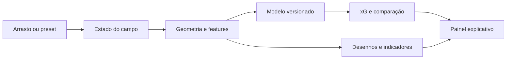

# Football, Visualized — arquitetura inicial

**Status:** decisão inicial, sujeita ao resultado do teste do modelo · **Atualizado:** 26/09/2026

## Forma da aplicação

Uma página pública com **Next.js (App Router), React e TypeScript**. O campo usa **SVG**; a interação usa **Pointer Events** para mouse, caneta e toque. A inferência roda no navegador com uma pequena função TypeScript e um artefato versionado do modelo. Sem autenticação, banco ou API de inferência na v0.1. Um script **Python** pode preparar dados e treinar/exportar o modelo durante o desenvolvimento; não roda a cada acesso ao site.

Essa escolha mantém deployment simples e cálculos rápidos. Se um modelo licenciado exigir runtime Python ou for grande demais, reavaliar o custo entre adaptar/exportar sua inferência e acrescentar um endpoint; **não assumir backend antes do teste do marco 2**.

## Fluxo de dados



O modo Aprender apenas muda quais instruções aparecem e quais estados antes/depois são comparados; usa exatamente o mesmo pipeline.

## Estado e geometria

Sistema interno único em **metros**, com dimensões fixadas na implementação (sugestão: campo 105 × 68 m; gol 7,32 m de largura), eixo `x` crescente rumo ao gol adversário e `y` transversal. A meia quadra é uma janela do sistema, não uma geometria diferente. A transformação para coordenadas da tela ocorre só na borda do SVG.

```ts
type Point = { x: number; y: number }; // metros, no campo completo
type Scenario = {
  id: string;
  shot: Point;
  goalkeeper: Point;
  defenders: Array<{ id: string; position: Point }>;
  shotType: "open_play" | "penalty";
};
type ViewState = {
  scenario: Scenario;
  mode: "playground" | "learn";
  locale: "pt-BR" | "en";
};
```

Manter `shotType` explícito impede tratar penalidade como uma finalização comum só porque a posição no campo coincide. Restringir pontos válidos ao campo e posições relevantes à região de jogo; manter IDs estáveis para o arrasto e para comparações.

**Features propostas, sujeitas à compatibilidade com dados e modelo:** distância do chute ao centro do gol, ângulo entre as traves visto do chute, distância do defensor mais próximo, quantidade de defensores no triângulo de chute, obstrução geométrica aproximada, distância do goleiro à linha de chute e ao centro do gol. Cada feature deve ter unidade, fórmula, regra de borda e equivalente na preparação dos dados. Atacantes adicionais ficam fora: sua posição não deve aparecer como variável influente sem suporte real do modelo.

## Módulo de previsão

Contrato: `predict(features, modelMetadata) → { probability, modelId }`, com `0 ≤ probability ≤ 1`. `modelMetadata` registra fonte dos dados, versão, features, população de chutes, tratamento de penalidades, calibração/avaliação e limitações. A UI lê esses metadados para dizer quais elementos realmente entram na estimativa.

**Seleção em duas etapas:**

1. Avaliar artefato pré-treinado com licença explícita que cubra reutilização, pesos acessíveis, entradas compatíveis com estado do campo e inferência viável. O SoccerBoard é referência de UX e investigação; repositório público por si só não autoriza copiar código ou pesos. Um modelo que só considera posição do chute não resolve a promessa de mover defensores e goleiro.
2. Caso não encaixe, fazer treinamento pequeno e reproduzível com eventos de chute e posições disponíveis, preferencialmente StatsBomb Open Data. Ajustar regressão logística a features reproduzíveis no navegador; separar dados por **partida**, documentar tamanho da amostra e inspecionar calibração, Brier score e resultados por faixas de distância. Guardar script e versão do artefato; creditar a fonte dos dados segundo seus termos. Não anunciar precisão profissional a partir de um teste visual de cinco presets.

O conjunto aberto da StatsBomb inclui eventos e arquivos 360 para partidas selecionadas; disponibilidade, forma das posições por chute e termos de uso precisam ser conferidos para a amostra efetivamente selecionada. **Não presumir que todo chute tenha freeze frame completo.**

## Explicações confiáveis

Uma camada de `describeScenario(features, locale)` transforma medições em observações. Outra `compare(before, after, predict)` mostra quais valores medidos mudaram e a diferença da previsão. Exemplos: “O ângulo passou de 18° para 31°; a estimativa subiu de 0,10 para 0,16”. Se houver múltiplas alterações simultâneas, dizer que **o conjunto da situação mudou**, sem repartir a diferença inteira entre fatores individuais.

Uma medição exibida (por exemplo, “parte do gol coberta”) pode ser **apenas descritiva**; a interface deve marcar isso caso ela não seja feature do modelo. Para destacar impacto de um único jogador, recalcular mantendo os outros elementos iguais. Isso é uma comparação contrafactual do modelo, sujeita a interações e à distribuição dos dados, não uma inferência causal sobre o jogo real.

## Localização e rotas

Usar dois dicionários pequenos, `pt-BR` e `en`, com chaves iguais. Rotas explícitas `/pt-BR` e `/en`; a raiz `/` escolhe uma rota pela preferência previamente selecionada e, na ausência dela, pelo idioma do navegador (`Accept-Language`), com fallback `en`. O seletor do topo preserva estado da simulação e modo ao trocar idioma; salvar a preferência em cookie. Presets guardam IDs e valores, nunca texto traduzido. Ajustar `<html lang>`, título, descrições e formatação decimal por localidade. A orientação de rotas segue a [documentação atual do Next.js](https://nextjs.org/docs/app/guides/internationalization).

Se implementarmos compartilhamento, codificar **uma versão curta do cenário** na URL, por exemplo `?s=...`, com posições normalizadas/limitadas, tipo do chute e IDs essenciais. Ao abrir, validar versão, limites, número de defensores e valores numéricos; dados inválidos caem em preset seguro. O idioma fica na rota, e o modo de entrada continua Playground. Sem links de encurtamento nem armazenamento no servidor.

## Organização sugerida

```text
app/[lang]/page.tsx              # entrada localizada
app/[lang]/layout.tsx            # idioma e metadados
components/Pitch.tsx             # SVG e interação
components/InsightPanel.tsx      # número, fatores e texto
components/LearnMode.tsx         # desafios opcionais
lib/geometry.ts                  # metros, ângulo, cone, coordenadas
lib/features.ts                  # estado → entradas do modelo
lib/predict.ts                   # inferência e metadados
lib/presets.ts                   # cinco cenários neutros
lib/scenario-url.ts              # somente se link compartilhável entrar
locales/pt-BR.json
locales/en.json
model/model.json                 # se artefato leve e licenciado/treinado
scripts/train_model.py           # somente se treino próprio for necessário
docs/                           # estes três textos quando forem ao repositório
```

## Qualidade e limites

- Testes direcionados a geometria, limites, features, inferência e inversão da tradução; revisão manual de arrasto em mouse e toque. Verificar as mesmas situações no treino e na aplicação.
- Para acessibilidade, oferecer foco visível, rótulos para peças, leitura textual do xG e controles por teclado/botões de ajuste de posição. O SVG pode ter muitos elementos decorativos; não poluir leitores de tela.
- Debounce visual apenas se necessário; primeiro medir. O número pode atualizar a cada movimento se inferência for leve.
- O modelo não conhece necessariamente técnica da finalização, jogador, movimento anterior, trajetória da bola, assistência ou pressão fora dos jogadores posicionados. Essas omissões devem ser legíveis no produto.
- Recriações de gols famosos exigirão fatos verificáveis e revisão do tipo de chute. Um voleio, uma cabeçada e uma falta não devem receber a etiqueta de “xG real” de um modelo treinado para chutes de jogo corrido.

## Fontes para a implementação

- [Next.js — internacionalização no App Router](https://nextjs.org/docs/app/guides/internationalization).
- [StatsBomb Open Data — formatos e termos de atribuição](https://github.com/hudl/open-data/blob/master/README.md).
- [SoccerBoard — referência funcional de campo e xG posicional](https://github.com/arnavmahadev/SoccerBoard); consultar status de licença antes de reutilizar qualquer artefato.
- [KU Leuven soccer_xg — exemplo de pacote Apache-2.0 para avaliar](https://github.com/ML-KULeuven/soccer_xg); conferir features e artefatos antes de escolher, pois licença clara não implica adequação ao campo interativo.
